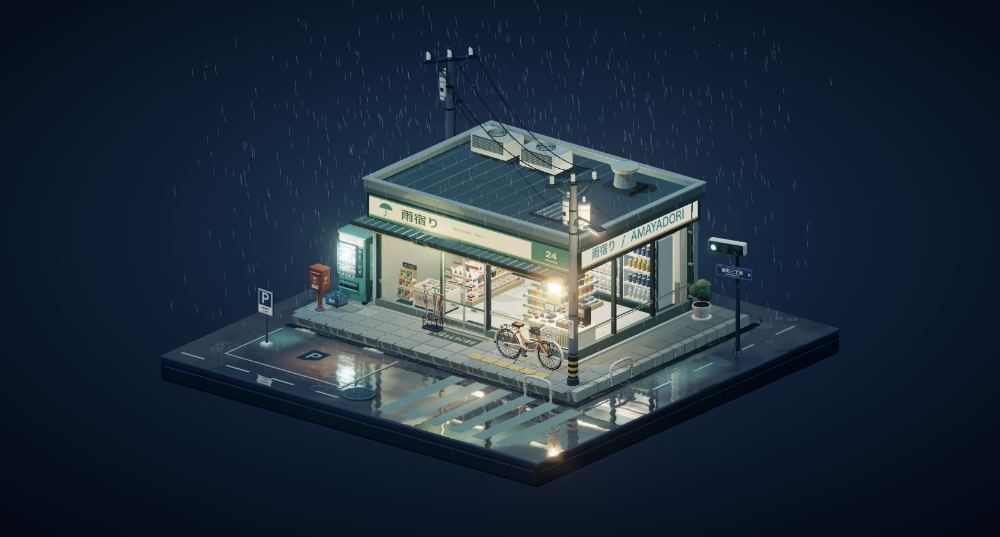

# 雨宿り · AMAYADORI

一个没有界面覆盖层的雨夜便利店微缩三维场景。所有建筑、货品、街道物件和纹理均由代码生成；不使用 Blender、外部模型或图片素材。



## 运行

```sh
npm install --ignore-scripts
npm run dev
```

生产构建：`npm run build`，预览构建：`npm run preview`。

## 观看

- 鼠标左键拖拽：环绕旋转。
- 鼠标右键拖拽：平移。
- 滚轮：缩放。
- 触摸屏单指旋转、双指缩放和平移。
- 双击场景：回到初始视角。

场景中没有按钮、面板或说明文字；文字仅出现在店铺招牌、商品包装、路牌等实体物件上。

## 制作

- Three.js 正交投影、分段明暗 Toon 材质、几何轮廓线、柔和阴影与适量辉光。
- 一体式正方形底座、L 形街道、独立铺装、路缘石、盲道、停车位、排水沟与人孔盖。
- 透明玻璃店面，内部货架、饮料柜、便当饭团、收银台、咖啡机等独立几何细节。
- 实时平面反射结合程序化沥青、水洼分布与细微水面扰动。
- 持续降雨、屋檐滴水、水洼涟漪、玻璃水痕、灯箱轻微闪烁、周期性自动门与交通灯变化。
- 静态几何按材质合批；门和天气独立更新。隐藏标签页时暂停动画时间。

需支持 WebGL 2 的现代浏览器，建议开启硬件加速。所有运行时依赖随构建打包，不依赖 CDN。
