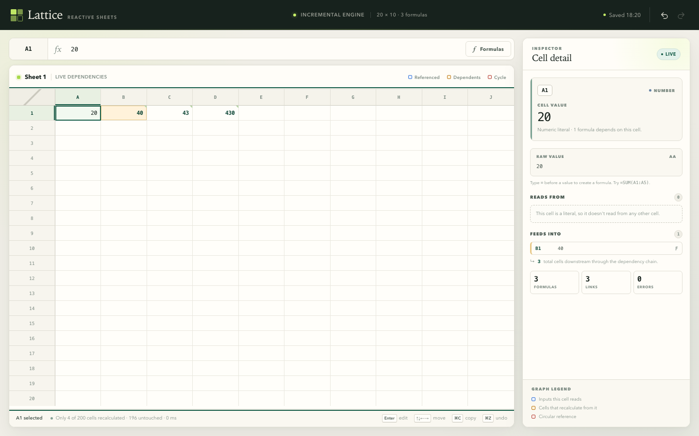

# Lattice — Reactive Spreadsheet

A compact, full-stack spreadsheet with a hand-written formula parser, a live dependency graph, incremental recalculation, cycle detection, and persistent workbooks.



## Quick start

Requires **Node.js 18+** (Node 20+ recommended). The app has **zero runtime dependencies**, so installation is instant.

```bash
npm install          # optional; there are no packages to download
npm run dev          # development server
```

Open **http://localhost:4317**.

Set a different port or host if needed:

```bash
PORT=8080 HOST=127.0.0.1 npm run dev
```

### Production build

```bash
npm run build        # copies the static client into dist/
npm start            # serves dist/ and the persistence API
```

Open **http://localhost:4317**. `npm start` intentionally fails with a clear message until `npm run build` has run.

```bash
npm test             # formula engine test suite (Node's built-in test runner)
```

The workbook is saved automatically to `data/workbook.json` (override with `DATA_DIR` or `WORKBOOK_FILE`). Delete that file to start with a blank workbook.

## Try the acceptance flow

Enter these values by clicking a cell, pressing **Enter**, typing, and pressing **Enter** again:

| Cell | Raw value |
| --- | --- |
| A1 | `10` |
| B1 | `=A1*2` |
| C1 | `=B1+5` |
| D1 | `=C1*10` |

1. Select **A1** and change it to `20`. The cells cascade to `B1 = 40`, `C1 = 45`, `D1 = 450`. The status bar reports only the four affected cells were recalculated.
2. Select **A1** to see **B1** highlighted amber as a dependent. Select **B1** to see **A1** highlighted blue and **C1** highlighted amber.
3. Create an indirect cycle: **F1** `=G1`, **G1** `=H1`, **H1** `=F1`. All three display `#CYCLE!`, are grouped in the inspector, and a downstream **I1** `=F1+1` receives `#CYCLE!` without hanging the app.
4. Use the toolbar arrows or **⌘Z / Ctrl+Z** and **⇧⌘Z / Ctrl+Y**. The undo history retains 100 cell-edit transactions (the requirement is 20).
5. Wait for the header to show **Saved**, then reload the page. Raw values, formulas, all computed values, cycle errors, and dependent links are restored.

Try `#DIV/0!` with `=1/0`, `#REF!` with `=K1` (outside the 10-column sheet), and `#VALUE!` with `=SUM(A1:A2)+"oops"` or `="hello"+1`. Errors propagate through formulas that consume them.

## Features

- **20 × 10 editable grid** with mouse, drag, and keyboard selection.
- **Keyboard-first editing**: arrows move, Shift+arrows extend a selection, Enter/F2 edits, Tab commits and moves, Escape cancels, Delete clears, Enter during editing commits and moves down.
- **Copy, cut, and paste** multi-cell TSV ranges, preserving raw values and formulas.
- **Formula parser and evaluator built from scratch**: A1 references, `+ - * /`, unary signs, parentheses, operator precedence, `SUM(range, ...)`, `AVG(range, ...)`, nested expressions, and ranges inside larger arithmetic expressions.
- **A real dependency graph**: range references expand into individual graph edges. Every edit parses only changed formulas, rewires their edges, finds the changed cell’s transitive dependents, and recalculates those cells in topological order. Unrelated cells are left untouched.
- **Direct and indirect cycle detection** with Tarjan’s strongly connected components. Every cycle participant is marked `#CYCLE!`; downstream formulas consume that error rather than causing recursion.
- **Error model** with `#DIV/0!`, `#REF!`, `#VALUE!`, and `#CYCLE!`, including propagation through operands and ranges.
- **Dependency inspection**: selecting a cell highlights inputs and dependents with distinct colors, while the inspector lists both, offers clickable jumps, shows transitive cascade counts, and explains errors and cycle membership.
- **Undo/redo** for 100 transactions, including single edits, formula-bar edits, clears, cuts, pastes, and undo-safe persistence.
- **Server-backed persistence** with atomic JSON writes, request validation, and stale-write protection. Every raw cell value is persisted; formulas are re-evaluated on load.
- **Formula view** toggles the whole grid between computed values and raw formulas. The raw formula is always in the formula bar and inspector.

## Controls

| Action | Shortcut / behavior |
| --- | --- |
| Select a cell | Click |
| Select a range | Drag, Shift+click, or Shift+arrow keys |
| Select all | ⌘A / Ctrl+A |
| Edit | Enter or F2 (or just start typing) |
| Commit | Enter (moves down) or Tab (moves right) |
| Cancel | Escape |
| Move | Arrow keys; Page Up/Down jumps eight rows |
| Clear selection | Delete or Backspace |
| Copy / cut / paste | ⌘C / ⌘X / ⌘V (Ctrl on Windows/Linux) |
| Undo / redo | ⌘Z / ⇧⌘Z or Ctrl+Z / Ctrl+Y |
| Show raw formulas | “Formulas” toggle in the formula bar |

The formula bar is editable directly. Select a cell, edit in the bar, and press Enter or click away. The active range is shown in the inspector when more than one cell is selected.

## Formula semantics

- Literal numbers are right-aligned; text is left-aligned. Leading `=` makes a formula.
- Blank cells are `0` in arithmetic and are ignored by `SUM`/`AVG` ranges. Text cells are ignored inside `SUM`/`AVG` ranges, but using text in arithmetic produces `#VALUE!`.
- A direct reference to an error propagates that error unchanged.
- `AVG` with no numeric inputs returns `#DIV/0!`.
- Unknown functions and syntax errors produce `#VALUE!`.
- References outside A1:J20 (including out-of-range ranges) produce `#REF!`.

Examples:

```text
=(A1+A2)*3-A3/2
=SUM(A1:A5)
=AVG(B1:B5)
=SUM(A1:A3)*2 + AVG(B1:B3)
=SUM(A1:A4, 10, C1*2)
```

## Architecture

```text
public/
  index.html          App shell
  css/styles.css      Visual design, sticky grid, dependency/cycle states
  js/engine.js        Shared pure-ESM parser, evaluator, graph, cycle detector
  js/app.js           Grid controller, keyboard/clipboard UX, history, autosave
server/index.js       Zero-dependency HTTP server, static files, workbook API
scripts/build.js      Production asset build and manifest
tests/engine.test.js  Engine and recalculation tests
data/workbook.json    Persisted workbook, created on first save
```

The formula engine is deliberately shared client/server-style pure ESM (the browser uses it; the server imports its address helpers for validation). Persistence stores **raw** values only, never cached results: after a reload the server returns raw cells and the client rebuilds its dependency graph and recomputes every value and error.

The persistence API:

- `GET /api/workbook` → `{ cells, updatedAt, revision }`
- `PUT /api/workbook` with `{ cells, version }` → saves raw cells atomically
- `POST /api/workbook` → same as PUT, used by the page-exit `sendBeacon`
- `GET /api/health` → server health

Writes are serialized and version-guarded so an old in-flight request can never overwrite a newer edit. The UI saves immediately after each transaction and also sends a final beacon on page exit.

## Verification performed

- `npm test`: parser precedence, unary operators, functions/ranges, forward references, multi-level cascades, graph rewiring, incremental affected sets, direct/indirect/self cycles, recovery from cycles, error generation/propagation, reload equivalence.
- End-to-end browser test: grid navigation, Enter editing, formula bar editing, a three-level cascade, dependency highlights, indirect cycle display, undo/redo, native clipboard copy/paste, formula view, and persistence across a full page reload.
- `npm run build` + `npm start` production smoke test.
